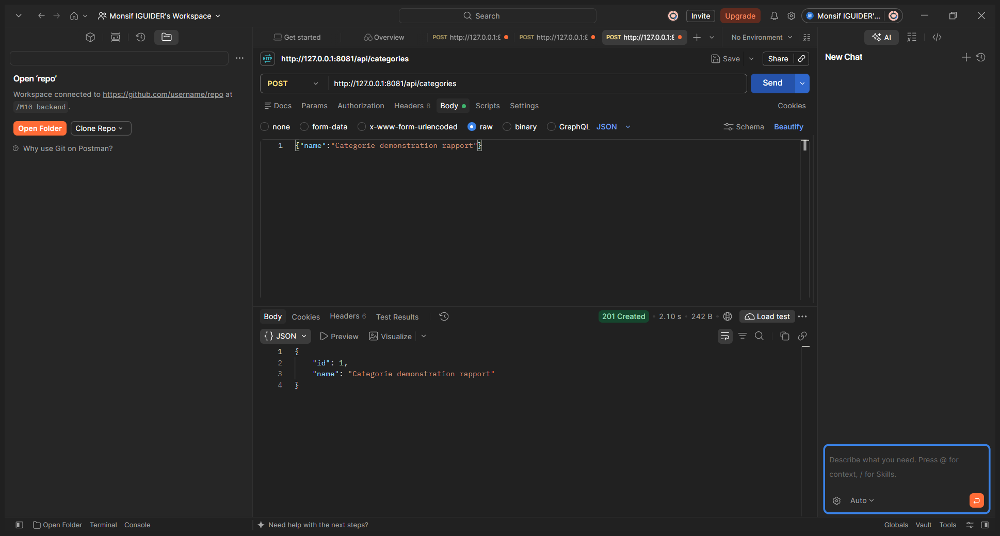
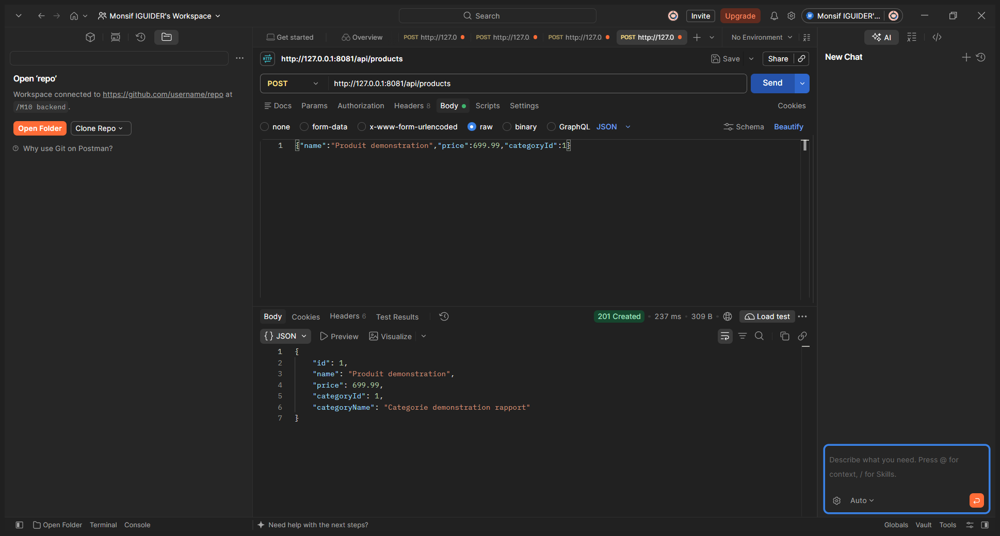
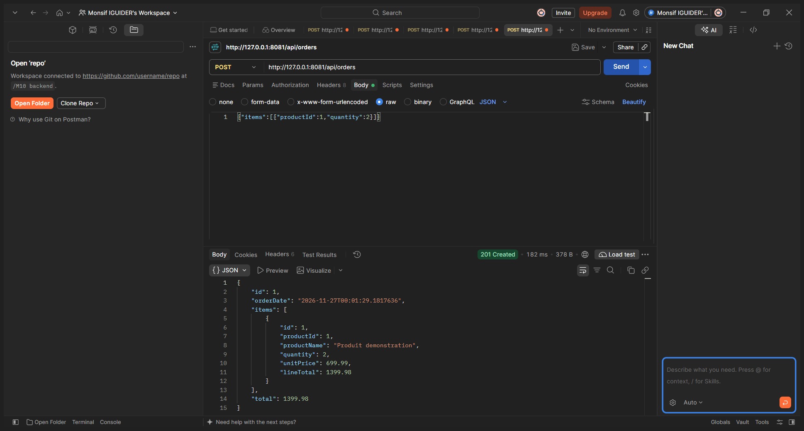
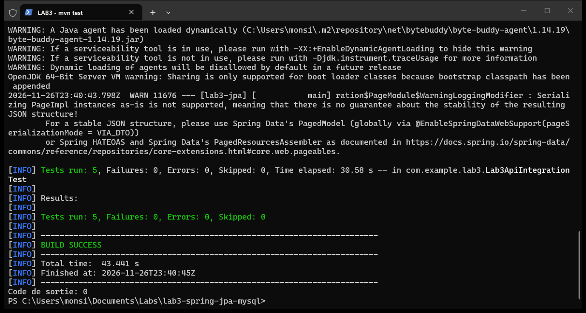

# Rapport de réalisation — LAB3

## API REST avec Spring Data JPA, Hibernate et MySQL

**Étudiant(e) :** ____________________

**Date de remise :** ____________________
**Projet :** [lab3-springboot](https://github.com/IguidMnsf/backend-labs/tree/main/lab3-springboot)

## 1. Objectif

Ce laboratoire fait évoluer l'API du LAB2 en ajoutant la persistance relationnelle. Il met en pratique Spring Data JPA, Hibernate, MySQL, les relations entre entités, les transactions et les réponses REST en JSON.

## 2. Réalisation

Le modèle comprend les catégories, les produits, les commandes et les lignes de commande. Les services utilisent des repositories JPA pour accéder aux données. Les réponses sont converties en DTO afin de ne pas exposer directement les entités de la base.

Les routes permettent notamment de créer et consulter les catégories et les produits, de rechercher et paginer les produits, puis de créer et consulter les commandes. Une commande mémorise le prix unitaire au moment de l'achat. La suppression d'un produit utilisé dans une commande est refusée pour préserver les références, avec le statut `409 Conflict`.

Le projet fournit Docker Compose pour démarrer MySQL. Les tests utilisent une base H2 isolée et ne dépendent pas de MySQL.

## 3. Vérifications

La commande `mvn clean verify` a été exécutée avec Java 21. Les **5 tests d'intégration H2 ont réussi**, sans échec ni erreur. Ils couvrent les opérations principales, les relations, la pagination, les commandes, la validation et les erreurs métier.

La configuration Docker Compose a été analysée avec `docker compose config`. Une démonstration ultérieure a utilisé une instance MySQL locale distincte de Docker : une catégorie, un produit et une commande ont été créés dans Postman.

## 4. Conclusion

Le laboratoire met en place une API structurée dont les données sont persistées dans MySQL et manipulées avec JPA. Les tests H2 valident le comportement applicatif sans exiger un serveur de base de données pendant la suite automatisée.

## 5. Captures des exécutions

**Création de la catégorie — HTTP 201 :**

**Création du produit lié à la catégorie — HTTP 201 :**

**Création d'une commande et calcul du total — HTTP 201 :**

**Tests automatisés — `mvn test` :**

